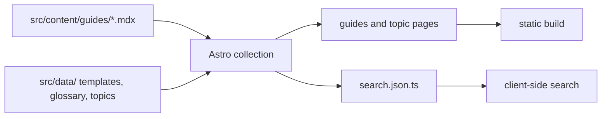

<div align="center">

# Law, Simplified

**Plain-English guides to Indian law — what your rights are and what to do next.**

[](https://adineo-cmd.github.io/law-simplified/)
   

[](https://github.com/adineo-cmd/law-simplified/stargazers) [](https://github.com/adineo-cmd/law-simplified/commits)

[Live site](https://adineo-cmd.github.io/law-simplified/) · [Quick start](#quick-start) · [How it works](#how-it-works) · [Features](#features)

</div>

---

Thirty practical guides cover the situations people actually search for:
refunds, security deposits, unpaid wages, FIRs and cyber fraud. Each guide
explains the rule, the steps to take and the paperwork to keep.

The site also ships **16 ready-to-edit templates** and an **89-term glossary**,
so the reader does not have to translate legal vocabulary alone.

## Features

| | Feature | What it does |
| --- | --- | --- |
| 📘 | **30 practical guides** | Written for the reader's situation, not for a law exam. |
| 🧰 | **16 templates** | Notices, complaints and letters with the blanks left visible. |
| 📖 | **89-term glossary** | Everyday explanations of the words that usually stop people. |
| 🔎 | **Static search** | A generated search index; no search service and no tracking. |

## How it works

Guides are MDX content, not hard-coded pages:

1. Each guide lives in `src/content/guides/` with front matter for topic and title.
2. `src/pages/guides/[...slug].astro` renders the collection.
3. Topic pages group guides by situation; the glossary and toolkit read their
   data from `src/data/`.
4. `search.json.ts` emits the search index at build time.



## Quick start

**Install and run**

```bash
npm install
npm run dev
```

**Production build**

```bash
npm run build
npm run preview
```

## Project structure

```text
src/
  content/guides/   30 MDX guides
  data/             templates, glossary, topics, FAQs
  pages/            guides, topics, toolkit, glossary, search endpoint
  components/       shared guide and chrome components
  styles/           typography and layout
public/             static assets
```

## Deployment

Every push to `main` builds the site and deploys it to GitHub Pages
through `.github/workflows/deploy.yml`:

**https://adineo-cmd.github.io/law-simplified/**

The output is fully static — no server, no database, no runtime environment
variables.

## A note on scope

This is an educational reference, not legal advice, and not a substitute for a
lawyer who knows the facts of a case. Every guide links back to the relevant
statute or official source where one exists.
